<!-- BBN:HEADER:START -->

<!-- BBN:HEADER:END -->

# BoomBigNose n8n Website

เว็บโปรไฟล์หน้าเดียวของ BoomBigNose ในฐานะผู้สอน n8n automation และเครื่องมือ AI บน YouTube มีส่วนความเชี่ยวชาญ เครื่องมือ (n8n workflow, Claude AI + n8n MCP) และผลงานเด่น ไฟล์หลักคือ index.html กับโฟลเดอร์ assets เปิด index.html ในเบราว์เซอร์หรือเสิร์ฟด้วย static server ใดก็ได้ ไม่ต้อง build

<!-- BBN:FOOTER:START -->
---

**สร้างโดย [BoomBigNose](https://github.com/Boom-Vitt)** · [Kruoop.com](https://kruoop.com) แหล่งเรียน AI + คอมมูนิตี้ · [Seeneo.ai](https://seeneo.ai) · [YouTube 220K](https://www.youtube.com/@BoomBigNose)

ถ้าโปรเจกต์นี้มีประโยชน์ กด ⭐ ให้กำลังใจกันได้เลย

<!-- BBN:FOOTER:END -->
